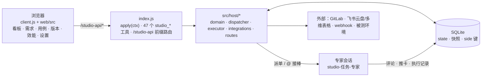
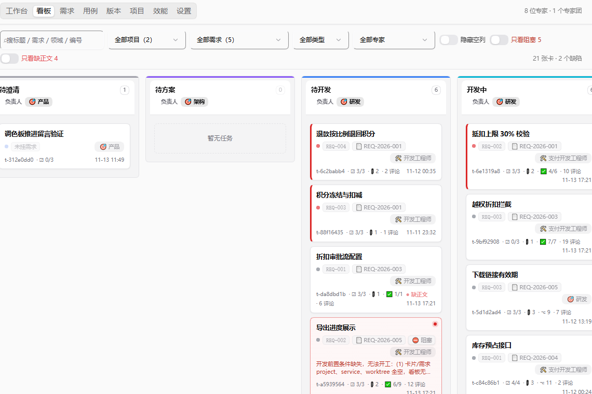
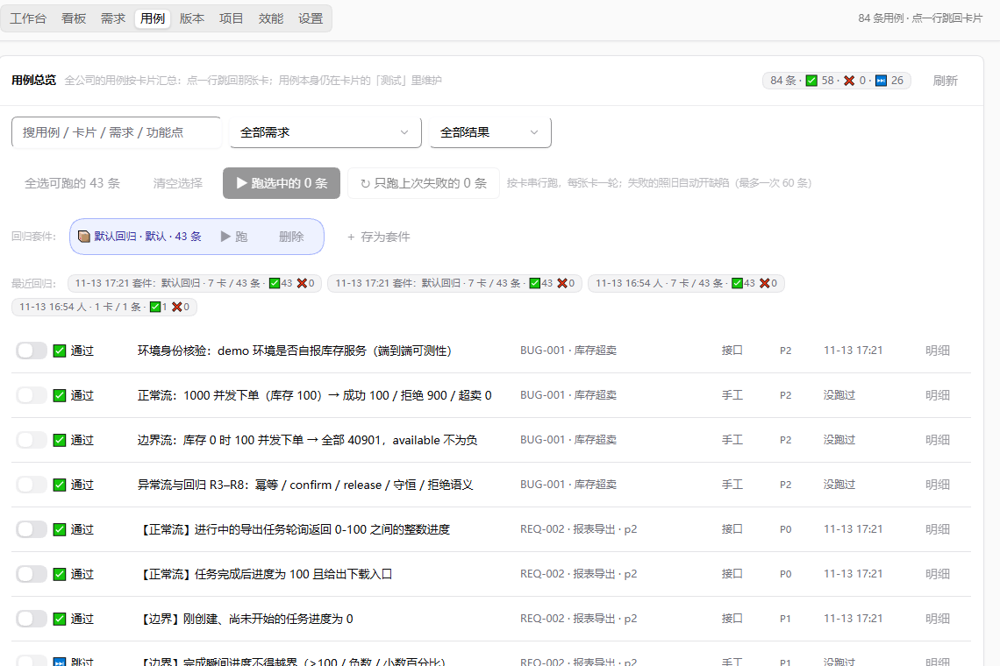
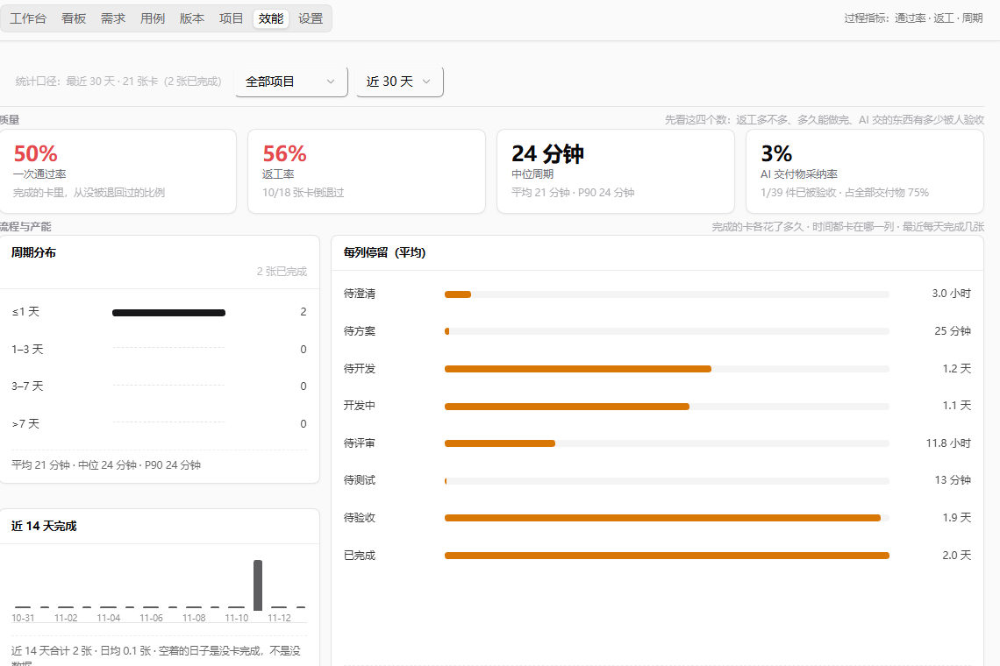

# dsh-studio

[](https://github.com/marsken88/dsh-studio/actions/workflows/ci.yml)
[](https://www.npmjs.com/package/@marsken/dsh-studio)
[](https://www.npmjs.com/package/@marsken/dsh-studio)
[](LICENSE)


给一家公司用的「需求&任务工作空间」：一个常驻的 DSH 插件，把**看板 + 角色 agent + 内部市场**装进 DSH Web 的同一个页面里。
自建 GitLab 管代码、飞书管交流，agent 负责产品 / 架构 / 研发 / 测试四个角色的具体活儿。

运行环境：DSH `>=0.2.2-rc.1`（宿主**最低**版本；实际验证过的组合与逐项依赖见 [docs/compatibility.md](docs/compatibility.md)），Node 22 以上，Linux/macOS（Windows 原生不支持 `link:` 安装 + systemd 托管）。

维护：供应链数字化组。有问题在本仓库开 issue，或直接找看板里的「产品」；发版流程见 [docs/publish.md](docs/publish.md)。

> **不知道怎么用？** 看 [`docs/manual.md`](docs/manual.md)：人从「一条需求的完整旅程」开始读，AI 直接看「工具用法」和「排障手册」。这份手册按「症状 → 先查什么 → 怎么修」组织，出问题先搜它。

## 功能地图

按「一条需求从生到死」的顺序排，细节见各专题文档；实现流水账在 [docs/history.md](docs/history.md)。

| 阶段 | 能力 |
| --- | --- |
| 需求 | 统一编号、功能点拆解、可追溯矩阵（可按编号/标题/验收条件筛、只看未覆盖；点「编辑」在表格上方就地改；勾选多个功能点可批量替换验收条件）、待确认清单、RICE 需求池、变更历史 |
| 澄清 | 拆卡前的必答项与门禁（`src/host/discovery.js`），答不全不许开工 |
| 设计 | **多稿对比与定案**：一卡多稿（名称 + 链接 + 一句思路），选定一稿才算定案；**「评审通过」不再等于放行**——被配成设计闸门的列要「定案 + 评审通过」才进得去，定案的那一稿会写进研发的派单提示词（`src/host/design.js`） |
| 执行 | 一卡一会话、一卡一 worktree；自动派单给产品/架构/研发/测试四类专家；顶栏**运行托盘** 1.5 秒轻轮询 `/agents`，谁在跑、有没有停摆一眼看到。**会话跑在卡所属项目的「本机代码目录」里**（worktree 建在仓库内 `.agents/worktrees`），并且建好后会 `attachSession` 挂进那个工作区的会话名单——宿主的工作区成员资格是显式名单（只在注册表首次初始化时按 cwd 归组一次），只跑对目录不挂名单，侧栏里照样是「未分组」；老会话在启动时会按 cwd 自动补挂一次。项目没配代码目录时才退回兜底工作目录（工作区名「Studio 工作区」）。**列多时看板默认压成一屏**（1440 下 8 列全可见），宽屏且列不多时保持可读列宽；勾选状态记在本地 |
| 项目 | 业务项目 / 迭代 / 多服务（每个服务自己的本机目录与基线分支）；卡片挂项目与服务，worktree 从服务目录切；项目页一眼看到各项目卡数、阻塞、逾期、周期；项目卡下方列出**未归属项目的卡**（没有时列最近更新），首屏不留空尾巴 |
| 自助提单 | 公开提单页与查询页：业务方无需登录提交需求、凭编号查进度；提交走限流与转义，不把 HTML 当内容渲染 |
| 交接 | 卡片上有**结构化交接契约**（决策 / 假设 / 未决 / 风险 / 影响面）；派单提示词**先读契约、再读最近评论**，换专家或换会话不用翻几十条评论猜结论 |
| 角色 | **四棒工作手册**：产品把需求挖到能验收（六段说明 + 功能点验收条件）、架构出可照做的方案（接口/数据/回滚/并发/性能/兼容/备选 + 给测试的测试线建议）、研发按定案实现并分层自测、测试按三层验；派单提示词按卡当前列注入对应手册，并带上「当前缺什么」的事实（缺验收、未定案、没执行记录…）。四棒共用**协作约定**：先读上游交接、逐条回应未决、给下一棒三句话、要谁配合就 @谁 |
| 协作链 | 卡片抽屉「概览」里有四行**协作链**：产品（功能点/验收条件）→ 架构（方案定案/评审）→ 研发（执行记录/项目检查/代码评审）→ 测试（单元/集成/端到端），缺哪一棒一眼看到 |
| 代码可见 | 不用自己敲 `git diff`：抽屉「执行记录 → 代码改动（git diff）」直接读卡的 worktree（没配就用项目/服务的本机代码目录），用 **BoardUI 树形视图**按目录分组列出改动文件（新增/修改/删除标记 + 每个文件 +N −M），点一个文件看逐行 patch 或切「全文」读工作树里的文件本体（带行号）；还有「还有 N 个文件没提交」的提醒。可复制路径 / 复制内容；有关联 MR 时直接跳 GitLab 的 files；提交多时按「某一次提交」看，文件多时按路径筛。卡面有「代码 +A −D」与「评审通过 / 评审要改」chip。**研发忘了登记执行记录时**，卡进「待评审」平台会从 worktree 的 git 事实补一条（agent 标成「git 自动采集」，不覆盖研发自报），不再是一张空白的「已评审」卡 |
| 评审可见 | 代码评审结论（`studio_task_coding action=review` 工具与面板两条路）都会**自动补成卡上的评论**（`代码评审 · 通过/要求修改（评审人）` + 意见正文），讨论区里一定看得到；以前走工具的评审只写 `coding.review.note`，人翻卡片时一个字都看不到 |
| 用例 | **三层测试：单元 / 集成 / 端到端**——每条用例带 `tier`（不写就按断言推断：单测命令→单元、接口/数据库→集成、真开浏览器→端到端）；**四种执行器：接口 / shell / 数据库 / 浏览器**（浏览器用例真开 Chrome 或 Edge，点按钮、填表单、断言页面上的文字与元素；默认关闭，和 shell 同一档开关）；**带可靠断言的用例写完当场试跑**；**卡上已有同名空壳时原地升级成可执行、不追加重复**；卡详情里的「测试」页有**三层进度条与每层结果**（通过数 / 可执行数 / 缺口 / 不适用理由），可一键「跑这层」，也能用 `studio_task_test_plan` 写明某层为什么不适用；跨卡用例总览（可只看无断言的那批）；**多步用例每一步可带自己的请求头**（环境 → 顶层 → 该步覆盖，变量用 `{{name}}`）；失败自动开缺陷卡；**需求文档（PRD / 验收标准）改版后，之前通过过的用例自动标「需复跑」**（只标不改，最后一次执行早于文档更新就算） |
| 合并 | 「能不能合」是独立一条门禁：评审、用例、项目检查、代码事实都对上才放行；结论发成 GitLab 提交状态，仓库开了状态检查就会拦住合并按钮 |
| 准出 | 卡片与需求两级准出（**代码评审没过也拦**）、验收清单、覆盖矩阵、人工签字（**取登录身份，不由请求体自报**）；项目配了检查命令后，**改过代码的卡没跑过 `npm run check` 这类本地质量命令不许收口**（结果是机器跑出来的，不靠自报） |
| 发布 | 版本 tag、灰度与部署记录、冒烟清单、发布门禁。**审批是门禁**：其它门禁（卡完成 / 用例 / 冒烟 / tag）清掉后「审批通过」才可点，审批记录留人、结论与时间；没审批不许发布 |
| 观测 | 工作台（在办/逾期/阻塞/**停摆**（含 running 挂死超 10 分钟）/缺陷/**强制放行超限**）、效能（周期分布/返工/AI 成本/**强制放行明细**/**自动化率**/**门禁一次通过率 · 派单周活 · 需求交付时长**）、燃尽 |

| 派单 | 专家会话**边跑边播报**：思考摘要 · 回复 · 工具 · **实际用的模型** 写成卡上的「执行中」评论（15 秒节流）；派单会话的提权审批由设置代答——默认**自动批准**（等于始终允许完全访问，DSH 弹审批时不需要人点），可改成自动拒绝；每次放行/拒绝都写成卡上评论留痕 || 集成 | GitLab（MR 事实对账）、飞书（云文档/多维表格/webhook）、**WeKnora 知识库（交付物可按出口投递，见下）**、内部市场 |
| 模型 | 派单前比对「会话当前模型 vs 配置」：不一致就 abort + 归档旧会话并按配置重建（会话的模型在创建时固化，改设置不影响老会话；以前配 Flash 实际跑 Pro 完全看不出来） || 沉淀 | **文档出口可切换**：只飞书 / 只 WeKnora / 两个都写（飞书为主，检索库失败不阻塞登记）；每个出口各记一份台账 |
| 评审 | 评审备注里写 `@专家名` 会**补成评论并派单**（以前只有评论解析 @，代码评审/设计评审的备注写了没人被叫起来）；代码块里的 @ 不算点名 |
| 签字·清单 | 验收签字备注、清单勾选备注里写 `@专家名` 也会**补评论并派单**（只有真 @ 了人才补，标题按来源写「代码评审 / 设计评审 / 验收签字 / 清单备注」）；需求评审备注除外（需求不挂卡，没有可派单对象） |
| 界面 | **全力转 BoardUI**：项目页先用上（统一卡片 / 数字 / 进度条 / 空态），对应的 `.ds-proj-*` 手写样式已删除；其余页面按批迁移 |
| 技能 | 技能库（落成 `SKILL.md`）；**做完的卡可以一键沉淀成技能草稿**——只搬卡上真实发生过的验收锚点/跑过的命令/踩过的坑/改动面，没有证据的卡直接拒绝；草稿默认停用，人启用后才注入派单；技能可限定项目范围；**技能库会显示它被用上过几张卡、其中几张被打回**（读台账，不加埋点） |
| 精选插件 | 官方插件页的「精选插件」生态接入：注册一个轻量入口 tab，未装完整版时引导一键安装 `dsh-featured`（搜索、标签筛选、一键安装、README 详情），已装则自动让位不会双 tab；**接入只提供入口，DSH Studio 是否上榜由 [skillpie.cn](https://skillpie.cn) 收录流程决定**（约定见 [dsh-featured/AI-INTEGRATION.md](https://github.com/skillpie/dsh-plugins/blob/main/dsh-featured/AI-INTEGRATION.md)） |

## 界面与组件

前端是单文件产物 `client.js`，界面组件统一走 **BoardUI** 的官方源码（MIT，原样引入，见 `web/src/components/base/**`），
自有样式只在 `web/src/index.css` 与 `web/src/boardui/**` 两处补位。

- 组件清单与取舍理由：[docs/ui.md](docs/ui.md)
- **空态即下一步**：每个"没有数据"的地方都给一个能点的动作（建第一张卡 / 新建需求 / 去看板），
  而不是只写一句说明
- 本地打过补丁的 vendored 文件只有两处（`notification.tsx` / `toast.tsx` 的 `container`），清单同样在 `docs/ui.md`

## 它是怎么跑的



一句话：**浏览器只认 `/studio-api`；状态全在 SQLite；专家是 DSH 会话，写回来的东西也落 SQLite；外部系统只被平台调用。**

## 它长什么样

| 工作台：今天该做什么、谁在忙 | 看板：八列、角色负责人、卡片带进度/用例、列宽可一屏看全 |
| --- | --- |
|  |  |

| 卡片抽屉：清单 / 用例（可归功能点）/ 执行记录 | 需求：基线、变更影响面、可追溯矩阵 |
| --- | --- |
|  |  |

| 用例库：跨卡聚合、套件、最近回归 | 效能：产品定义的五条指标（门禁一次通过率 · 自动化率 · 交付时长 · 用例覆盖 · 派单周活）+ 用例缺口清单 + 其它读数 |
| --- | --- |
|  |  |

| 版本：发布、灰度、部署记录 | 设置·测试执行：执行开关、数量上限、出站 webhook |
| --- | --- |
|  |  |

| 设置·成本与预算：价目表（元/百万 token） | 设置·专家：专家名册、模型与提示词 |
| --- | --- |
|  |  |

| 设置·列的负责人：**设计闸门 / 评审闸门**（默认开）+ 每列候选人 | 设置·技能库：沉淀的技能、被用上几张卡、返工率 |
| --- | --- |
|  |  |

设置页有**未保存提醒**：文本改过却没点保存时，页内会挂一条黄色提示，切到别的分区会先确认「丢弃并切换」——18 个分区里那些「改完点保存」的字段不会再静默丢。页面级草稿（看板外观 / 角色与模型 / 自动派单）的**保存条粘在面板底部**，滚到哪都能直接点，并标「未保存」；其余分区是分区保存（抽屉 / 行内按钮）或即时保存的开关（一拨就生效），不强行合并——不同对象混成一个大草稿容易误保存。

截图不是手截的：`npm run shots -- --base http://127.0.0.1:<dsh 端口>`（`tools/visual/capture.mjs`）
会造一套**演示数据**（标题都带「演示·」）、用**真实 client.js** 渲染面板、逐页截图并断言没有「渲染失败」，
跑完把数据连同云盘目录一起删掉。界面一改重跑一次即可，不用再手工对齐尺寸和演示内容。

## 安装

两种装法，任选一种。**装的是 npm 上的发布版**（带构建好的 `client.js`，不需要本地构建）。

### 方式一：从 npm 装（推荐）

```bash
# 全局级安装进当前 DSH profile 的插件目录
dsh plugin --profile web install @marsken/dsh-studio

# 或者用 npm 直接装进 profile
npm install --prefix ~/.dsh/profiles/web @marsken/dsh-studio

# 确认挂载 + 重启
dsh --profile web --dump-config | grep -A2 'dsh-studio'
sudo systemctl restart dsh-web
```

升级到新版本：

```bash
dsh plugin --profile web install @marsken/dsh-studio@latest
sudo systemctl restart dsh-web
```

> **只装 `@latest`，不要装 `@next`。** `next` 是预发布通道：2026-11-18 试发的 `0.2.2-rc.1` / `rc.2` / `rc.3`
> 是调 CI 的构建（同一小时里连发三次），之后仓库再没发过预发布，`next` 就一直钉在 `0.2.2-rc.3` 上 ——
> 装 `@next` 拿到的是**早于全部功能、并且对着老宿主接口写**的插件：面板可能照常出现，工具却落在旧契约上。
> 0.9.16 起 `npm run verify:release` 会断言「`next` 不比 `latest` 旧」，三个 rc 也已在 npm 上标记弃用。

### 方式二（可选）：从 GitHub Packages 装镜像

只在内网/CI 只能访问 GitHub 时用。**作者在 npm 上的账号是 `marsken`（所以主包是 `@marsken/dsh-studio`），
在 GitHub 上是 `marsken88`（所以仓库是 `marsken88/dsh-studio`）——同一个人的两个平台账号。**
镜像因此只能叫 `@marsken88/dsh-studio`：GitHub Packages 的 npm 源要求 scope 等于仓库 owner，
而 npm 的 scope 与 GitHub 用户无关。两个包内容一致、版本号同步。

```bash
# 需要一个有 read:packages 权限的 GitHub token
echo "//npm.pkg.github.com/:_authToken=${GITHUB_TOKEN}" >> ~/.npmrc
dsh plugin --profile web install @marsken88/dsh-studio
```

> 镜像里的 `cordis.patch.yml` 已经改组内包名，所以装它不会出现「模块找不到」。
> 但**别把两个装进同一个 profile**：它们注册的是同一个面板与同一批工具。

> **已经装过 0.5.1 及更早版本的，先看这里。** 那些版本的 `cordis.patch.yml` 里把包名写成了裸名
> `dsh-studio`（真实包名是 `@marsken/dsh-studio`），加载器按裸名去 profile 的 `node_modules` 里解析，
> 结果是 `plugin.not-loaded` + `Cannot find package 'dsh-studio'`——面板、工具、路由全都不会出现。
> 0.5.2 起改成完整包名。升级后如果还是不加载，把 profile 里那一行改掉或删掉再装一次：
>
> ```bash
> # 1) 删掉旧的挂载行（id: dsh-studio / name: dsh-studio 那两行）
> grep -n -A2 'id: dsh-studio' ~/.dsh/profiles/web/cordis.patch.yml
> # 2) 重新装一遍，确认宿主认到了
> dsh plugin --profile web install @marsken/dsh-studio@latest
> dsh --profile web --dump-config | grep -A2 'dsh-studio'
> sudo systemctl restart dsh-web
> ```

### 方式二：从源码装（要改代码时）

```bash
git clone https://github.com/marsken88/dsh-studio.git ~/dsh-studio
cd ~/dsh-studio && pnpm install && pnpm --dir web run build   # 改过 web/src 才需要构建

# 装进目标 profile（写 profile 的 package.json + bundles，走 pnpm link）
dsh plugin --profile web add link:~/dsh-studio

dsh --profile web --dump-config | grep -A2 'dsh-studio'
sudo systemctl restart dsh-web
```

### 验证装好了

浏览器打开 DSH Web，左侧栏出现「需求&任务工作空间」；或直接打接口：

```bash
curl -s http://<host>:<port>/studio-api/state | head -c 80   # 应返回 {"ok":true,"revision":...}
```

## 安全与来源边界

默认**不启用登录**（`access.enabled=false`），开箱即用。这个模式下有三类操作只允许在
**服务器本机（127.0.0.1）**执行，其他机器调用会返回 `403 local_only`：

| 限制的操作 | 为什么 |
| --- | --- |
| 插件安装 / 卸载（市场） | 装的是任意 npm 包，含 install 脚本 = 宿主 RCE |
| 快照恢复 | 一次覆盖整个数据库，不可撤销 |
| 审计 / 派单日志导出 | 内容是操作人姓名与操作路径 |

其余管理操作（角色模板、项目、集成、成员权限）与全部业务读写不受影响。要在局域网里做上面三件事，
先到「设置 → 权限与审计」开启登录。

另外两条与安全有关的默认值：

- **需求里的外部链接只接受 http(s) / mailto / 站内路径**，`javascript:` 一律被丢弃（防存储型 XSS）。
- **更换 LDAP 服务器地址必须重新输入服务端账号口令**，不会拿已保存的口令去连新地址。
- 页头显示「· 默认口令」说明还在用 `admin`：去「设置 → 统一登录」改掉。
- 开启成员名单后，**项目 / 专家 / 团队配置、技能上传、合并 MR、灰度回滚、清库**只有管理员能做；
  成员可以推卡、写评论、跑用例、签名交付物。

## 发版

打 tag 即自动发版，不需要任何令牌：

```bash
npm version 0.2.5 --no-git-tag-version
cd web && pnpm run build && cd .. && npm test
git commit -am "chore(release): v0.2.5"
git tag -a v0.2.5 -m "v0.2.5" && git push && git push origin v0.2.5
```

GitHub Actions（`.github/workflows/release.yml`）会依次：校验 tag 与 `package.json` 一致 →
语法 → 契约测试 → 构建 → 产物可复现 → 用 **Trusted Publishing(OIDC)** 发布到 npm（带 provenance，
不依赖长期令牌）→ 等 registry 出现该版本 → 正式版再核对 `npm latest`。

## 质量闸门

两类 HTML/CSS 抓不到的回归，现在由构建期守卫和真库自检挡住：

| 命令 | 挡什么 |
| --- | --- |
| `cd web && npm run guard` | CSS 里写回 `hsl(var(--x))`（颜色解析失败）、Radix Portal 忘记 `container={portalRoot()}`（弹层「存在但不可见」）、产物丢失门户作用域属性 |
| `npm run smoke:store -- ~/.dsh/dsh-studio.db` | 用生产库的 `.db/-wal/-shm` 副本在本地跑真实启动路径，抓「空库能起、真库就炸」的 `ReferenceError` |
| `npm run verify:desktop` | 桌面版（Electron 客户端）验收：插件是否加载、`/state.profile` 是否等于当前 profile、`/market.installed` 里有没有本插件、破坏性路由是否要求 `confirm`。**客户端半边（侧栏入口/面板渲染）验不了** —— 桌面窗口走 `dsh-app://` + 启动令牌，脚本会列出人工确认项 |
| `npm run verify:empty` | 空数据巡检：把 `/state` 换成一"刚装好、什么都没建"的样子，走一遍全部页签 —— 空看板这类分支只有新装用户才会走到（issue #6 就是这么漏的） |
| `npm run shots -- --base <端口>` | README 截图：造演示数据 → 真 `client.js` 渲染 → 逐页截图到 `docs/images/`，跑完自删（含云盘目录）。**界面一改就重跑**，别手工截图——2026-11-20 那批图停在 11-18，中间左栏、闸门、BoardUI 全变了 |
| `npm run drive:gc -- --base <端口>` | 云盘孤儿目录体检/清理：**只删「名字像 REQ-* 且台账里没有引用」的文件夹**，项目目录/未归属项目/看不懂的一律保留，文件永不删。默认只体检，`--apply` 才真删（进回收站），串行 + 退避重试（并发会被飞书判 resource contention） |
| `npm run probe:panel -- --base http://127.0.0.1:<端口>` | 面板**渲染**：假宿主挂真实 `client.js` + 把 `/studio-api/*` 反代到正在跑的实例，puppeteer 逐页断言并截图到 `tmp/probe/`。接口测试与单测看不见「渲染在哪个面板里」——0.9.36 就有开关插错面板而全绿的情况。自己造「（探针）」数据、跑完自删；没装 puppeteer-core 或没 Chrome 时跳过不判红 |
| `npm run verify:mirror` | 本地演练 GitHub Packages 镜像的改名步骤（只在打 tag 时才跑的东西，提前在本地验一遍） |
| `npm run verify:tdz` | 作用域级“先用后声明”扫描（TDZ）：浏览器里的 `Cannot access 'x' before initialization` 就是这么来的，`node --check` 查不出。已接进 `release:check` |
| `npm run verify:pack` | 打包后自检（**验的是要发的 tarball**）：patch 在包里且 `name` 等于包名、`exports`/`dsh` 指向的文件都在、`index.js` 能被真的 import。已接进 `release:check` |
| `npm run release:check` | 发版前文档自检：CHANGELOG 有本版条目、compatibility 版本号一致、README 提到的脚本都存在；**改了代码却没改 README 会直接红** |
| `npm test` | 契约测试（**条数以 `npm test` 输出为准，不在文档里写死**）：manifest、产物哈希、宿主接口、跨模块导入、只读绑定赋值、迁移与文档一致性、门禁纯函数、快捷键解析 |

真机验收（需要 `STUDIO_TOKEN`，对着测试机跑，非零即红）：

| 命令 | 覆盖 |
| --- | --- |
| `npm run verify:pages` | 8 个页面能进、能渲染、页签高亮、无 pageerror、每页与卡片抽屉的交互节点都有可访问名称（45 项；CI 也跑） |
| `npm run verify:audit` | **29 个模块**（8 页签 + 18 设置面板 + 3 抽屉）里还有没有原生下拉/原生输入/老按钮（违规必须为 0） |
| `npm run verify:selects` | 下拉是否都是官方组件、尺寸是否合规范、弹层是否真的在最上层 |
| `npm run verify:drawer` | 抽屉打开/聚焦/Esc/取消（15 项） |
| `npm run verify:drawertabs` | 卡片抽屉里 9 个内层页签 |
| `npm run verify:auditlog` | 审计日志是官方 Table + 每页 50 行 + 翻页生效（7 项） |
| `npm run verify:toast` | toast 真的出现在门户容器里、有尺寸、4 秒后消失（7 项） |
| `npm run verify:cases` | 用例库里草稿看得见、筛得出来：`只看无断言` 选中后只剩草稿，切回全部行数复原（8 项） |
| `npm run verify:tiers` | **三层测试端到端**：真宿主（`apply(ctx)` + 真路由 + 临时 SQLite，不碰用户库）+ 真 client.js + 真 Chrome。验 `/state` 的 `caseTiers`、卡片正面缺层提示、抽屉三层进度块、`不适用 + 理由` / `恢复适用`（真的发请求）、「跑这层」真执行、缺口消失后的门禁与无 pageerror（31 项） |
| `npm run verify:a11y` | 无障碍：6 个页签的正文对比度（WCAG AA）、交互元素可访问名称、Tab 焦点可见、卡片抽屉的 dialog 语义与焦点圈；`A11Y_THEME=dark` 量暗色 |
| `npm run verify:ax` | 无障碍树（CDP AX tree）：交互节点命名、可聚焦却被 ignored、标题跳级、对话框名称。**暂未接入发版闸门**；8 页签 + 抽屉的 AX 命名检查已并入 `verify:pages`，真机 `verify:ax` 仍需 token 复跑 |
| `npm run review:layout` | 24 个模块的字号/溢出/内联硬编码颜色巡检 |
| `npm run review:components` | 官方元素 vs 自研元素的分布，看还有哪些组件没换 |
| `npm run audit:ui` | unslop 口径的界面体检：32 个面（7 页签 + 设置 18 分区 + 抽屉 5 页签 + 命令面板 + 新建抽屉）逐面截图 + 采 computed style 指标（4px 网格、字号档位、颜色 token、emoji、圆角、对比度、首屏空白、网格落单、文字截断）。**只出证据不改代码**，结论见 `docs/ui-audit-2026-11-24.md`（首次审计 11-22，复审报告含本轮修复项） |
| `npm run audit:overlays` | 浮层/交互态体检：确认框 / 输入框 / 下拉 / @ 选择器 / 新建技能 / 新增专家 / 登录，逐层截图并量字号档位、非 4px 网格、emoji、可关闭入口 |
| `npm run audit:static` | 三个公开页（提单 / 我提过的 / 查进度）在 1200 与 390 两种宽度下的渲染体检（字号档位、非网格、溢出） |
| `npm run audit:state` | 空态 / 登录页 / 大数据量 / 375 宽：改写 `/state` 响应造状态，逐面截图并量字号、非 4px 网格、溢出、截断 |
| `npm run audit:interact` | 交互细节：Tab 焦点环是否可见、禁用态、卡片悬停、拖拽是否进入 dragging |

`pnpm build` 已串上守卫（`make-legacy → guard --pre → vite build → sync-client → guard --post`），CI 也会跑：忘记构建或写出上面两类样式，流水线直接红。

## 门禁链（从澄清到发布）

平台不是「拖过去就算完」：每一步都有东西看着，**拦的只有必须在场的东西，其余一律只提示**——提示多了会被无视，拦多了会被绕过。

| 阶段 | 检查 | 拦不拦 |
| --- | --- | --- |
| 澄清 | 三问必答（有没有服务端 / 鉴权谁做 / 交付边界） | **拦**：答不完拆不了卡 |
| **拆卡** | 功能点没有**可判定的验收条件**（只写了「体验良好」不算） → **拦**（默认开，`config.requirementGate.requireAcceptance=false` 才关）。报错会点名是哪个功能点；产品用 `points[].acceptance` 补齐 | **拦**：没有验收条件，研发只能猜、测试只能编 |
| 设计 | 评审通过但**没定案**（多稿里没指认哪一稿），或一稿都没有；**或评审人就是稿子的作者（自审）** | **拦**：先把稿放进去、指认一稿、让**另一位**评审人下 approved（`override` 可强推）。**默认开**（`config.design.enabled=false` 才关；关着时推进会在卡历史里留痕） |
| **评审** | 进「待测试」时代码评审还没结论（**默认开**，`config.reviewGate.enabled=false` 才关；关了会在看板顶部挂提示、设置页显示「已关闭」） | **拦**：改完先让评审人用 `studio_task_coding action=review` 给结论（`override` 可强推） |
| **用例** | 代码/测试类卡（开发/测试/缺陷）**一条用例都没有** → **拦**（默认开，`config.caseGate.enabled=false` 才关；关掉后仍 warning） |
| **三层测试** | 代码/测试类卡上**单元 / 集成 / 端到端**三条线里，某条既没有可执行用例、也没有在测试计划里写明「不适用 + 理由」→ **拦**（默认开，`config.caseGate.tiers=false` 才关）。缺口在卡片正面与抽屉「测试」页都看得见；用例的 `tier` 可不填，按断言推断 |
| 拆卡 | 说有后端，但功能点没有一条讲接口 / 数据表 / 鉴权 | 提示 |
| 拆卡 | 说没有后端，功能点却要建表 / 写接口 | 提示 |
| 卡准出 | 清单没勾完 / 有用例失败 / 卡被标阻塞 / 没人签字 | **拦**（`override` 可强推，须写原因并留痕）；**签字是 AI 写的直接拦**（专家名册里的名字算 AI） |
| 卡准出 | 项目/服务配了本地质量命令（`npm run check` 之类），卡上有代码改动却**没跑过或跑挂了** | **拦**：抽屉「执行记录 → 项目检查」里跑一次，退出码与输出写回卡片 |
| **合并** | 评审没通过 / 可执行用例没跑过或有失败 / 项目检查没跑或没过 / 执行记录与代码对不上 / GitLab 流水线失败 | **拦**：门禁通过后**由平台调用 GitLab 的 merge API** 真正合并（`POST /task/merge`、`studio_merge_gate action=merge`），没过就拒绝且不碰 GitLab。同时把结论发成提交状态 `studio/merge-gate` 作为可见记录。**为什么不是"拦按钮"**：GitLab CE（极狐 15.3 实测）没有外部状态检查、也没有 approvals API，状态灯拦不住人工合并——所以让合并**由平台执行**才是真拦。卡上记「已合并」同样要先过这一关。**这条门禁不看验收签字**：合并看证据，验收看人 |
| 需求准出 | 没有产品输出 / 评审没过 / 有待确认问题 / 卡没完成 / 卡在阻塞 / 缺陷未关 / 用例失败 / **一条跑过的用例都没有** / 没签字 / **签字是 AI 写的** | **拦**（`override` 可强推，须写原因；**每一次强推都会记进效能页**） |
| 需求准出 | **可执行用例占比低于 60%**（只有标题的用例跑不了，也不算验过） | **拦**：给出 `可执行 1/4` 这样的读数和目标值，补上断言再签 |
| 需求准出 | **卡上没有产品/架构专家的讨论**（只有自动跑用例的汇总）、RICE 没打分、功能点没被通过用例覆盖、**有用例没跑过**、**有用例被标跳过**、**「通过」是手标的没有执行记录**、**有卡是强推的**、没有交付物 | 提示 |
| 发布 | tag 名、关联卡、冒烟清单、**发布审批**（版本上没人点「审批通过」并写结论） | **拦**：先审批，再发布 |

> 需求签字前会先算准出门禁；确实要提前签就传 `override` 写一句原因，原因会出现在需求准出里——**逃生舱可以开，但要留痕**。
> 新加一条门禁或一条体检，必须同时进 `npm run selfcheck`（连跑三轮的闭环断言），否则它只是写在代码里的建议。

## 更多文档

| 想了解 | 看这里 |
| --- | --- |
| **产品定义**（目标用户 / 核心场景 / V1 范围 / 可观察验收标准） | [docs/product.md](docs/product.md) |
| 登录与免登录（LDAP / 本地超管 / 会话落库） | [docs/auth.md](docs/auth.md) |
| 界面实现（shadcn 对齐 / 构建链 / 布局一致性 / 暗色巡检） | [docs/ui.md](docs/ui.md) |
| 第一天上手（三条命令，全新 clone 验过） | [docs/quickstart.md](docs/quickstart.md) |
| 发版到插件市场 | [docs/publish.md](docs/publish.md) |
| 宿主接口依赖与升级 runbook | [docs/compatibility.md](docs/compatibility.md) |
| 过程记录（按日期的实现流水账） | [docs/history.md](docs/history.md) |
| 每个版本改了什么 | [CHANGELOG.md](CHANGELOG.md) |

## 开发与兼容性

- 参与开发（构建链、部署、验证要求、禁区）：[AGENTS.md](AGENTS.md)
更新日志（每版改了什么、有哪些已知限制）：[CHANGELOG.md](CHANGELOG.md)
上手第一天（三条命令，已在全新 clone 上验证过）：[docs/quickstart.md](docs/quickstart.md)
发布到插件市场（npm / GitHub 发版 + 收录条目 + 自查清单）：[docs/publish.md](docs/publish.md)
- 依赖的 dsh 宿主接口、升级 runbook、兼容矩阵与已知限制：[docs/compatibility.md](docs/compatibility.md)

## 参与贡献

| 想做什么 | 看这里 |
| --- | --- |
| 本地跑起来、改代码、提 PR | [CONTRIBUTING.md](CONTRIBUTING.md)（含 **`TZ=UTC npm test`** 这条容易漏的门槛） |
| 报告缺陷 / 提功能建议 | [issue 模板](https://github.com/marsken88/dsh-studio/issues/new/choose) |
| 报告安全问题 | [SECURITY.md](SECURITY.md) —— **不要开公开 issue** |
| 判断一个功能该不该做 | [docs/product.md](docs/product.md) 的 V1 范围与「明确不做」清单 |
| 社区行为准则 | [CODE_OF_CONDUCT.md](CODE_OF_CONDUCT.md)（Contributor Covenant 2.1） |
| 无障碍支持范围与已知限制 | [ACCESSIBILITY.md](ACCESSIBILITY.md)（量出来的，不是承诺） |

## 已知限制

- 上下文**构成占比**（工具 / 助手 / 输入）是按会话日志文本体积估算的，不是引擎账目：宿主把 `sessionProjections` 暴露给了插件，`tokenMeasurement` 就是引擎计量，但 `stateOf()` 要**活会话对象**，只能在派单收尾时取——还没接（调研结论见 `docs/history.md`）。**占用率已经是真实数据**（用 `request/context` 的 `contextWindow`）。
- 多维表格镜像是**手动触发**的（`POST /studio-api/feishu/mirror`，支持 `dryRun` 先看会写多少条）：一条记录 = 一张卡，200 条一批串行写；表里要有「编号 / 标题 / 状态 / 负责人 / 优先级 / 需求 / 更新时间」这几列。**还没在真实表格上验证成功路径**——本机 lark-cli 未完成用户授权时，它会如实返回 authorization 错误而不是假成功。
- GitLab 同步 Issue 与**关联 MR**（`/issues/:iid/related_merge_requests`）；卡上挂 MR 后「从 GitLab 核对」会拉 MR 详情、`/changes` 与 `/pipelines`（流水线状态进 `coding.gitlab`）。**不同步 MR 的评论**；MR 的合并/关闭状态要等下一次同步才反映到卡上。
- 用例现在有两种：**带可执行断言的**（`studio_task_add_cases`：接口给 `method`/`path`/`expectStatus`，shell 给 `command`）与**只有描述的**（`studio_task_case`）。前者**写完会当场试跑第一条**，跑不通就把原因原样回给专家去改，写不出来的（只有标题、没有断言）直接拒收；后者能在卡上留档、能人工填结果，但**不计入「可执行覆盖率」**——那一栏只认真的能跑的用例（`src/host/case-strength.js`）。**卡上只要还有这种用例，任何列的专家接单时都会在提示词里看到「N 条用例没有可执行断言」**，并被要求补上或说明为什么补不了；用例库也能「只看无断言」把它们筛出来。
- **三层测试是另一把尺子**（`src/host/test-plan.js`）：每条用例有个 `tier`（`unit` / `integration` / `e2e` / `other`），没写就按断言推断——`browser` → 端到端，`http` / `db` → 集成，shell 命令里出现 `node --test` / `jest` / `pytest` 等 → 单元，`playwright` / `cypress` 等 → 端到端。代码类卡的准出要求**每条线要么有可执行用例、要么在测试计划里写明不适用 + 理由**（`studio_task_test_plan`；`config.caseGate.tiers=false` 可关）。测试专家的派单提示词会带上：需求功能点与验收条件、**这张卡当前三层的进度与缺口**、每层怎么落（shell 跑单测 / 多步接口与数据库断言 / 浏览器走用户路径），以及缺层时是用例补还是写不适用。
- 用例记录存在卡上（`task.cases`）：跨卡的**用例总览**页签可以勾选批量跑（结果回写各自卡、失败照旧开缺陷），也支持**回归套件**（`/suite/*`：按规则或手选固定一批，一键重跑，`by` 记「套件：名字」）。但还没有「回归套件」这个对象——固定的用例集合、一键重跑、历次通过率趋势都还没有，批量跑是临时勾选、跑完即散。
- **重复提交靠 `Idempotency-Key` 挡**：同一个 key 的 POST 只执行一次，之后回放第一次的响应（响应头 `x-idempotent-replay: 1`）。**不带这个头就还是每发一次执行一次** —— 自己的脚本要幂等就带上它。有效期 24 小时，最多记 200 个 key。
- **验收条件是同一条线**：功能点的每条验收条件在拆卡时变成卡的验收清单项（id 保持一致），用例可以挂 `acceptanceId`，矩阵只有「挂在它自己身上的通过用例」才算覆盖某条条件。以前是「功能点任意一条用例通过 → 所有条件都标覆盖」，所以「5/5 覆盖」可能只对应 1 条用例。
- **三个节奏指标的口径**（效能页）：门禁一次通过率 = 到过待验收且完成的卡里「第一次就没被打回」的占比；
  派单周活 = 一周内有 AI 评论的卡片数（目标 ≥15）；需求交付时长 = 需求创建 → **验收签字**的中位数
  （不是发布：版本对象上没有「需求什么时候上线」的可靠时间）。口径写在 `src/host/delivery.js` 文件头。
- **事件可以按 seq 回查**：`GET /studio-api/events?since=<seq>&limit=100&type=task/moved` 返回 `{ lastSeq, total, events }`。
  webhook 收到的每条事件都带 `seq`，且**先写进账本再投递**（落账失败就不发），所以外部永远查得到自己收到的那一条。
  账本保留最近 500 条，`seq` 只增不减（重启也不回退）。
- **并发改同一张卡会冲突，不会静默覆盖**：卡上有 `version`，`/task/update` 带上 `ifVersion` 时，基于旧版本的写入会拿到 **409 + 当前卡**。面板与 agent 目前不传 `ifVersion`（保持老行为），所以这条**只对你的脚本/集成生效**。
- 缺陷卡的严重级别默认 `P2`、优先级 `normal`：自动建卡不猜严重程度，由人或在评论里改。
- 派单失败会记在 `/studio-api/integrations` 与卡片抽屉里，并按 `agentRetryPlan` **自动重试**（间隔递增、有上限）；超过上限才挂阻塞等人。
- 集成健康现在会**落盘保留最近一次结果**（SQLite 的 `meta:side:integration-health`，不进 state、不涨 revision、不占快照）：重启 dsh-web 后四条通道不再回到「还没用过」。仍然只是「最近一次」，没有按小时/按天的长期趋势（要趋势还得上采集）。
- 工具层权限只认会话名（`studio-<taskId>-<expertId>`）：如果哪个 agent 用了别的会话名，就会被当成「名单外」拦下写操作，需要在审计里看一眼。
- 同一张卡在同一列只自动派一次（防止来回循环），需要再跑一轮就点「马上处理」，或在评论里 `@` 它。
- 并发上限是全局的（设置 → 自动派单 → 同时最多几个 agent，默认 2）：名额满了新卡就排队，把在跑的会话停掉或把上限调大即可。
- 删掉卡片会自动收回它占用的名额（原来会留一个幽灵会话把并发名额占死，已修）。
- 专家团是「团长 + @ 接棒」的协作模式；2026-11-13 起有**团级记忆**：卡推进到「完成」时自动记一条（做了什么、遗留什么），派活时把这个团最近 5 条塞进专家提示词；0.1.24 起**同一条经验出现 ≥2 次会提炼成「这次先规避」的约束**（记忆里反复踩的坑才会变成硬提示），避免同一批人反复踩同一个坑。记忆存在 SQLite 的 side 键里，最多每个团 20 条，可在「设置 → 专家团」里清空。
- 新写或改写的技能对**已经开着的会话**不立即生效（技能目录在会话开始时枚举），开新会话或下一次派单即可看到。
- 「从链接拉飞书正文」与「产物归档到飞书云盘」都依赖宿主机的 `lark-cli` 与有效的用户授权；`auth status` 里 user 不是 ready 时页面会提示，按提示重新授权即可。
- 归档出来的是云盘里的 Markdown 文件，不是飞书在线文档：同事能打开、能下载、能被搜索，但不能在线协同编辑与评论；正文由平台覆盖更新，人工在飞书上改的内容下次覆盖会丢。
- 归档是同步写：一次要写很多产物时（比如批量补历史）会挨个调 `lark-cli`，几十份文档需要十几秒到几十秒。
- 需求基线是快照：可以**逐行对比**「基线 vs 最新 PRD」（只读，`web/src/studio/diff.js` 的 LCS），也**可以回滚到基线**——
  回滚是实质变更：正文回到基线那一版、文档版本号 +1、原来的验收签字作废，并在文档历史里留一条「PRD 回滚」（谁回滚的、从哪一版）。
  「设为基线 / 对比基线 / 回滚到基线 / 取消基线」四个入口都在需求详情的「文档与基线」里；需求的评审仍是人工点按钮，没有独立审批流。
- 「从链接拉正文」支持飞书的 docx / wiki 链接（走宿主机 `lark-cli docs +fetch`，飞书云盘的 `file/` 链接会明确被拒）；
  拉回来的正文可以直接设为基线。这一步 2026-11-17 在一篇真实 wiki 文档上验过（标题与 1715 字正文都拿到了）。
- AI Coding 执行记录由 agent/人登记；卡上挂了 MR 后「从 GitLab 核对」（`/coding/gitlab`）会拉 MR 详情、`/changes`（改动文件清单 + 提交数）、
  `/commits`（逐条提交）与流水线做事实比对：**自报的每个提交都要按 sha 前缀在 MR 里找得到**，对不上的单独列在抽屉里，不静默覆盖。
  流水线有测试报告时（`/pipelines/:id/test_report`）还会比自报的单测数；仓库没产出报告就退一步数 job 成败（那是任务数，不跟单测数比）。
  仍缺：CI 产物本身（构建物、报告文件）不下载，只记数字；真实 `git.lyf.com` 令牌还没接通，这条链目前用 `tools/mock-gitlab.mjs` 打桩验过。
- 「业务负责人」与「期望完成」是可选项：没填时抽屉里显示「未指派」/「未排期」，不是数据丢失；需要时补上再点「保存改动」。

## 破坏性接口需要 `confirm`（0.9.6 起）

删数据、清审计、改成员权限、动发布这类路由，现在要求请求体带一个确认词，否则 400 `confirm_required`：

| 路由 | 需要带 |
| --- | --- |
| `/task/delete` `/requirement/delete` `/release/delete` `/projects/delete` `/repos/delete` `/bots/delete` `/experts/delete` `/teams/delete` `/suite/delete` `/skills/delete` `/access/delete` | `confirm: "DELETE"` |
| `/audit/clear` `/team/memory/clear` | `confirm: "CLEAR"` |
| `/snapshot/restore` `/market/install` `/market/uninstall` `/release/publish` `/release/rollback` `/reset` | `confirm: "RESTORE" / "INSTALL" / "UNINSTALL" / "PUBLISH" / "ROLLBACK" / "RESET"` |
| `/access/save` | `confirm: "SAVE ACCESS"` |

面板自己会自动带上（界面上本来就有确认对话框），只有自己写脚本调接口时需要注意。
这不是权限系统，是防止「空 body 打一下就把审计/成员删了」的护栏 —— 真正的鉴权仍然靠登录。

## 本地开发：把插件挂进某个 profile

`dsh plugin --profile <p> install` 会自动做下面两件事，**手工装必须两件都做**，少一件都看不到面板：

1. `~/.dsh/profiles/<p>/package.json` 的 `dependencies` 里加 `"@marsken/dsh-studio": "link:<仓库路径>"`
2. **同一份 package.json 的 `dsh.profile.bundles` 数组里加 `"@marsken/dsh-studio"`** —— profile 的插件树
   是按这个数组逐层合成的（`cordis.yml` 里写着「each bundle in package.json's dsh.profile.bundles」），
   只在 `dependencies` 里出现**不会加载**
3. 然后 `node_modules/@marsken/dsh-studio` 要真的指向仓库（Windows 没管理员权限建不了符号链接时，
   直接把这几个文件拷进去：`index.js client.js package.json cordis.patch.yml locale src`）
4. **重启 dsh**（桌面端：退出并重开客户端）—— host 半边只在启动时加载

挂好之后自检：`curl -s localhost:<port>/studio-api/state | head -c 80` 应该返回 `{"ok":true,...}`。

## 装完不对劲先看这里

| 现象 | 原因与处置 |
| --- | --- |
| 装了插件但侧栏没有「需求&任务工作空间」（`studio_*` 工具能用、看板数据也在） | 浏览器端注册名必须等于**包名**。0.9.0/0.9.1 的产物里写的是短名 `dsh-studio`，宿主按包名取工厂取不到 → 模块不实例化 → 侧栏入口根本没注册。**升到 0.9.2** |
| 写工具报 `recordAudit is not defined` | 0.9.0/0.9.1 的 `src/host/tools.js` 裸引用了宿主函数（没走注入）。**升到 0.9.2** |
| 用 `@next` 装的，面板/工具行为莫名其妙地旧 | `next` 通道曾长期指着 `0.2.2-rc.3`（2026-11-18 的预发布调试图），比 `latest` 落后十几个版本。改装 `@latest`；核对：`npm view @marsken/dsh-studio dist-tags` 里 `next` 要么没有，要么不旧于 `latest` |
| 桌面版（Windows/macOS 客户端）里抽屉头部的「关闭」被窗口按钮盖住 | 覆盖层要避开窗口顶部那条标题栏。0.9.13 起改成**量**那条 `-webkit-app-region: drag` 标题栏的高度（env(titlebar-area-height) 在客户端里实测为 0，UA 里的 Electron 段也可能被去掉）；系统标题栏更高就改 `--ds-titlebar-floor` |
| 提示 `ERR_MODULE_NOT_FOUND` / 装完不加载 | 0.5.1 及更早的 `cordis.patch.yml` 里写的是裸名 `dsh-studio`。**升到 0.5.2+**（`npm run verify:pack` 会拦这类问题） |

## 许可证

Apache-2.0，见 [LICENSE](LICENSE)。仓库里不含公司数据，配置示例里的地址 / token / 主机名都是占位值。

